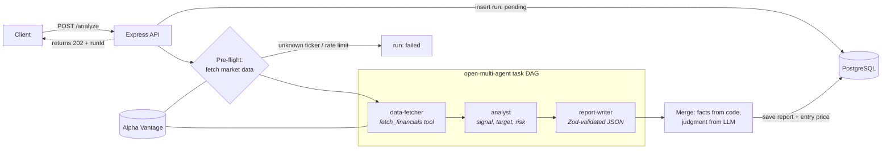

# Equity Research Agent

A REST API that turns a stock ticker into a structured investment research report. Three AI agents (built on Claude with [`@open-multi-agent/core`](https://github.com/open-multi-agent/open-multi-agent)) work as a pipeline: one fetches market data, one analyzes it, and one writes a Zod-validated report. Reports are saved to PostgreSQL, and a backtest grades past recommendations against the prices that came after them.

```
POST /analyze { "ticker": "AAPL" }  →  202 { runId }
GET  /reports/{runId}               →  { recommendation: "buy", targetPrice: 245, riskScore: 4, ... }
```

## Architecture



**How a request flows**

1. `POST /analyze` records a `pending` run and returns `202` right away. The pipeline runs in the background.
2. **Pre-flight check.** The orchestrator fetches market data *before* calling any LLM. An unknown ticker, a bad API key, or a rate limit fails the run without spending tokens. The response is cached, so the agent's tool call reuses it at no extra API cost.
3. **The agents run in dependency order:**
   - `data-fetcher` calls the `fetch_financials` tool.
   - `analyst` interprets the data and proposes a buy/hold/sell signal, a target price, a 1–10 risk score, and risk flags.
   - `report-writer` writes the result as JSON that must pass a Zod schema.
4. **Facts come from code; judgment comes from the LLM.** The ticker, company name, date, and all metrics (P/E, P/B, 52-week momentum, YoY revenue growth) are computed in code and overwrite whatever the model wrote. The LLM decides only the recommendation, target price, risk score, summary, and risk flags.
5. The report is saved with the latest close price as its **entry price**, so it can be graded later.

## Backtesting without look-ahead bias

A recommendation can only be judged on prices that came *after* it was made. The backtest has two steps:

| Step | Command | What it does |
|------|---------|--------------|
| 1. Generate | `npm run backtest:generate [TICKERS...]` | Runs the pipeline today and stores each report with today's price as the entry price |
| 2. Evaluate | `npm run backtest:evaluate` | Grades every ungraded report that is at least 30 days old, using the close 30 days after its entry date |

Grading rules:

- **buy** is correct if the price rose.
- **sell** is correct if the price fell.
- **hold** is correct if the price moved less than ±3%.

Each report is graded once (enforced by a unique index), so `evaluate` is safe to run every day. Results are available at `GET /backtest/summary` and `GET /backtest/results`.

> `evaluate` uses the most recent ~100 trading days of prices, so grade reports within about 4 months of their horizon date.

## API

| Method | Path | Description |
|--------|------|-------------|
| `POST` | `/analyze` | Body `{ "ticker": "AAPL" }`. Starts an analysis and returns `202 { runId, ticker, status }` |
| `GET` | `/reports/:runId` | Run status (`pending` / `running` / `failed`), or the full report once `completed` |
| `GET` | `/reports?ticker=&limit=&offset=` | Report history, newest first (`limit` defaults to 50, max 200) |
| `GET` | `/backtest/summary` | Overall hit rate and a breakdown by recommendation |
| `GET` | `/backtest/results` | Every graded outcome with its entry and exit prices |
| `GET` | `/health` | Health check |

**Report shape** (validated with Zod in [src/agents/report-writer.ts](src/agents/report-writer.ts)):

```jsonc
{
  "ticker": "AAPL",
  "companyName": "Apple Inc",
  "analysisDate": "2026-11-09",
  "recommendation": "buy",          // "buy" | "hold" | "sell"
  "targetPrice": 245,
  "riskScore": 4,                   // integer 1–10
  "metrics": {
    "peRatio": 29.5,                // null when unavailable (e.g. negative earnings)
    "pbRatio": 45.2,
    "momentum52w": 0.12,            // fraction: 0.12 = +12%
    "revenueGrowthYoY": 0.061
  },
  "summary": "2–3 sentence investment memo",
  "riskFlags": ["P/E well above sector median"]
}
```

## Getting started

**Prerequisites**

- Node.js 18 or later
- Docker (for PostgreSQL)
- An [Anthropic API key](https://console.anthropic.com)
- A free [Alpha Vantage API key](https://www.alphavantage.co/support/#api-key)

```bash
npm install
cp .env.example .env          # then fill in ANTHROPIC_API_KEY and ALPHA_VANTAGE_API_KEY

docker compose up -d          # PostgreSQL 16 on localhost:5432
npm run db:init               # create tables
npm run db:migrate-backtest   # add backtest tables and columns

npm run dev                   # http://localhost:3000
```

Try it:

```bash
curl -X POST localhost:3000/analyze -H "Content-Type: application/json" -d '{"ticker":"AAPL"}'
curl localhost:3000/reports/<runId>
```

### Scripts

| Script | Purpose |
|--------|---------|
| `npm run dev` | Start the API with hot reload |
| `npm run build` / `npm start` | Compile to `dist/` and run |
| `npm run db:init` | Create the `analysis_runs` and `reports` tables |
| `npm run db:migrate-backtest` | Add the backtest tables and columns (safe to re-run) |
| `npm run backtest:generate` | Step 1 of the backtest |
| `npm run backtest:evaluate` | Step 2 of the backtest |

## Project structure

```
src/
├── index.ts                 # Express app and error handling
├── orchestrator.ts          # Pre-flight check, agent team, task DAG, fact/judgment merge
├── agents/
│   ├── data-fetcher.ts
│   ├── analyst.ts
│   └── report-writer.ts     # Report Zod schema
├── tools/
│   ├── alpha-vantage.ts     # API client: error detection, caching, metric computation
│   ├── fetch-financials.ts  # Tool exposed to the data-fetcher agent
│   └── get-historical-price.ts
├── routes/
│   ├── analyze.ts           # /analyze and /reports
│   ├── backtest.ts          # /backtest/*
│   └── async-handler.ts
├── backtest/
│   ├── common.ts            # Horizon, hold band, grading rules
│   ├── generate.ts
│   └── evaluate.ts
└── db/
    ├── client.ts
    ├── init.ts
    ├── migrate-backtest.ts
    ├── reports.ts           # saveReport()
    └── schema.ts            # Row types
```

## Design notes

- **Alpha Vantage returns HTTP 200 for errors.** Rate limits and unknown symbols come back as a JSON body with `Note`, `Information`, or `Error Message`. The client checks for these and throws, so an agent never analyzes an error message as if it were data.
- **The LLM does no arithmetic.** Metrics are computed in code and passed to the agents already calculated. This removes a common source of silent errors, such as mixing up percentages and fractions.
- **Rate-limit budget.** Each analysis makes 2 Alpha Vantage calls (`OVERVIEW` and `TIME_SERIES_WEEKLY`), cached for 10 minutes. Grading makes 1 call per ticker. The free tier is small (5 calls per minute, plus a daily cap), so the backtest scripts wait between tickers.

## Limitations

- **Fundamentals are not point-in-time.** The data reflects the latest filings, and there is no historical fundamentals data. This is why the backtest only looks forward.
- **Results need time.** The backtest needs 30 days between generating and grading, and a meaningful hit rate needs many graded reports.
- **No job queue.** The pipeline runs inside the API process, so a restart loses in-flight runs and leaves them marked `running`.
- **Not investment advice.** This is an engineering project.

## Tech stack

TypeScript · Node.js · Express · `@open-multi-agent/core` · Anthropic Claude · Zod · PostgreSQL (`pg`) · Alpha Vantage · Docker Compose
